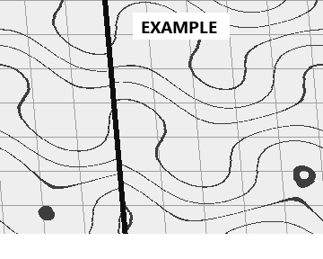
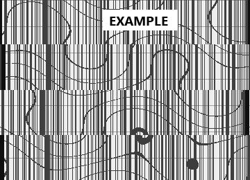

# FLdigi Image Tools — short manual

**This portable x64 build requires 64-bit Windows.** It works with either 32-bit or 64-bit FLdigi.

Extract the package to a writable folder, keep [`Cleaner.ini`](./Cleaner.ini) beside `FldigiImageTools.exe`, and double-click `FldigiImageTools.exe`. No installer or separate AutoHotkey installation is required. If you have only the source files, see [Running from source](https://github.com/BattleHook/fldigi-image-tools#running-from-source).

**Where to change FLdigi paths:** The app displays the ADIF logbook path as read-only and has no Settings dialog for these paths. If the defaults match your FLdigi setup, leave them as they are. Otherwise, open [`Cleaner.ini`](./Cleaner.ini) in a text editor and change `Path` under `[Logbook]` for the ADIF file or `Folder` under `[Rule WEFAX]` for the PNG folder. Save the file, then click **Scan** to use the new paths. No restart is required.

## 1. Clean up missing-image entries

1. Click **Scan**. It reads the logbook without modifying it.
2. Select a result to see the full path. Check only the entries you want to remove.
3. Close FLdigi. Click **Apply selected removals** and confirm. The tool rechecks the selection and saves a timestamped `.bak` beside the logbook before replacing it.

If FLdigi puts a `File:` line before the ADIF header, the tool preserves that line during cleanup. You do not need to edit the logbook before scanning.

**A `.bak` is a copy of the entire logbook, not an undo list.** Restoring it puts the logbook back exactly as it was when the backup was made. For example, if the cleaner removed two entries and you logged three new contacts afterward, restoring the backup brings back the two removed entries but leaves the three new contacts out of the restored logbook. Later edits, such as a new `ENH:` link, are also lost from the restored logbook. The image files themselves are unaffected.

To undo a cleanup, close FLdigi and save a separate copy of the current ADIF before replacing it with the appropriate `.bak`. If you want to keep newer entries or edits, compare the backup and current copy and merge only the records you need instead of replacing the whole logbook.

## 2. Correct a WEFAX image

1. Choose **WEFAX Images**, select a chart, and click **Open Image**. Compare the original with the adjusted preview.
2. Use **Tilt** for steady sideways drift and **Alignment** to move the seam. Try **Auto Tilt** or **Auto Align**, then fine-tune by 1 px (`<` / `>`) or 10 px (`<<` / `>>`).
3. Use **Repair Steps** for sudden sideways jumps. Click the adjusted image to open **Step Zoom**. Use **Row −/+** to navigate and **Shift −/+** to correct; uncheck **Apply** to compare without the selected repair. **Track Line** can follow a clear vertical feature where it can identify it confidently. Review any automatic result.
4. Crop unwanted edges using the four **Crop** controls.
5. **Save PNG As** suggests `<original-name>_adjusted.png` and exports the corrected pixels without guides or a logbook change. To link a separate `_enh.png` in the same log entry instead, close FLdigi and choose **Save Enhanced + Log**. Both leave the original intact.

**Export JSON** saves the adjustments, not the image. To resume, open the same original image and choose **Import JSON**. JSON import/export share their last-used folder; PNG export remembers a different one.

In the image browser, **Move to Recycle Bin** moves only the original PNG. Close FLdigi first and confirm the displayed path. The app reads the logbook to verify the link but **does not write to it**: `NOTES` keeps the original `RX:` path and any existing `ENH:` link. The enhanced PNG, if present, stays where it is.

On the next **Scan**, an existing enhanced PNG at a valid `ENH:` link keeps the entry off the cleanup list. If the original is gone and there is no enhanced image still linked and present, the entry can be listed for review. It is not removed unless you select it and confirm **Apply selected removals**.

## What changes the logbook, and when does the list refresh?

| Action | Writes to the ADIF? | What refreshes? |
|---|---|---|
| Adjust the image, **Save PNG As**, or **Import/Export JSON** | No. | The editor preview updates when adjustments change. The cleanup list stays as it was. |
| **Save Enhanced + Log** | Yes. It backs up the ADIF and adds `ENH:` to `NOTES`, leaving `RX:` intact. | No automatic refresh. After a successful save, click **Refresh List** to run the same read-only check as **Scan** without closing the editor. Reopen **WEFAX Images** to see the new link. |
| **Move to Recycle Bin** | No. `NOTES` and both links stay unchanged. | The original disappears from the image browser. Click **Scan** to update the cleanup list. |
| **Apply selected removals** | Yes. It backs up the ADIF and removes only the checked records that still qualify. | The cleanup list rescans automatically. |

**Refresh List** and **Scan** read the current logbook and recheck image paths, including changes unrelated to the saved image. Both rebuild the cleanup list and clear any previous check marks. Neither writes to the logbook.

## Practice with synthetic images

Both PNGs are marked **EXAMPLE** and generated from scratch. They contain no DWD imagery or received station data. Open PowerShell in the extracted app folder (with the `examples` folder beside the EXE) and run this command to preview both PNGs without reading or writing your station logbook:

```powershell
.\FldigiImageTools.exe --preview "examples\synthetic-tilt-and-crop.png" "examples\synthetic-line-jumps.png"
```

In the preview, choose **WEFAX Images**, then open an example:

### Tilt and crop



Set **Tilt** to `25`, **Alignment** to `-117`, and **Crop Bottom** to `28` to straighten the chart, move the wrapped seam to the edge, and remove the blank strip.

### Line jumps



Leave **Tilt** at `0` and click **Repair Steps**. Look for three sideways jumps near rows 65, 131, and 196. Select one and toggle **Apply** to compare, or click the image to inspect it in **Step Zoom**.
